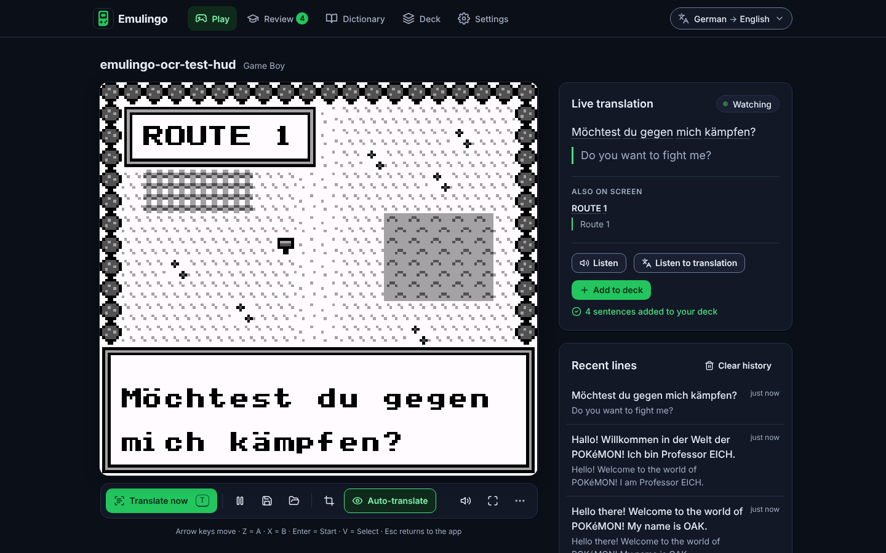
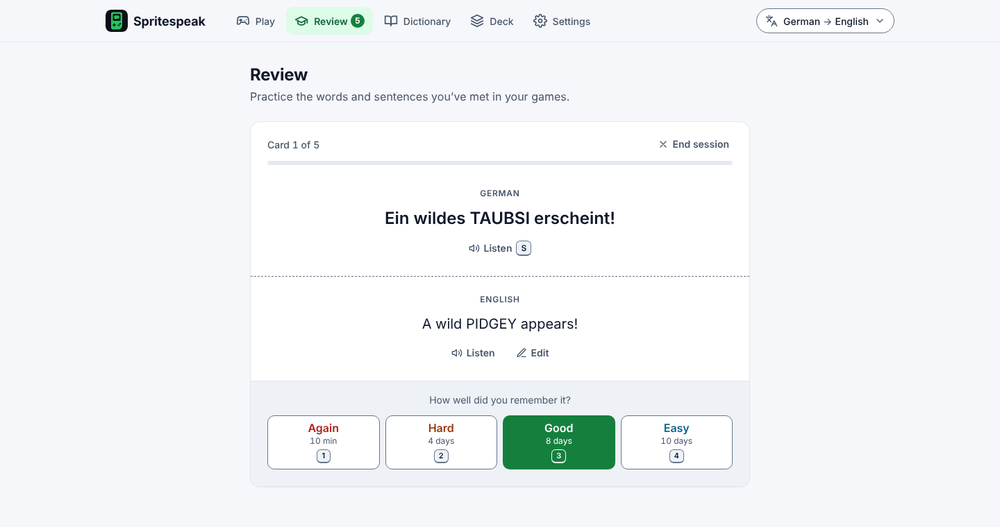
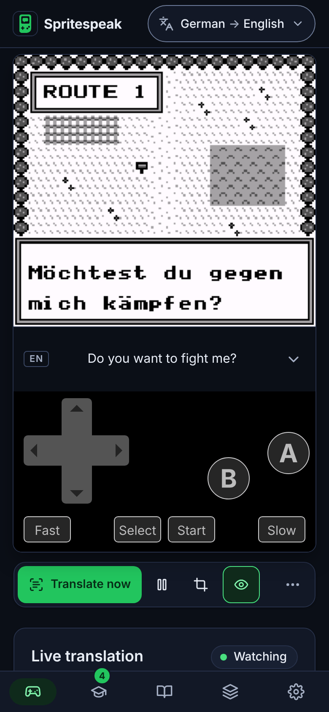

# Spritespeak

**Play retro games you own and learn a language as you go.**

Spritespeak runs classic console games in your browser, reads the text on the game screen, translates it line by line and turns what you read into flashcards. Play a Pokémon game in German, French or Spanish, and the dialogue you meet becomes your vocabulary list.

Everything except translation happens on your device: the emulator, the text recognition, your games, saves and flashcards. There’s no account and no Spritespeak server.

> Spritespeak doesn’t include any games. Use ROM files of games you own, or homebrew and public-domain games.

Spritespeak was called Emulingo until October 2026 ([what that means for you](#formerly-emulingo)).



<p>
  
  
</p>

<sub>The screenshots show Spritespeak’s own homebrew test cartridge (`bench/e2e/make-gb-rom.mjs`).</sub>

## Features

- **Built-in emulator** – [EmulatorJS](https://emulatorjs.org) 4.2.3, with keyboard and gamepad support and a touch gamepad on phones and tablets.
- **Made for phones** – held upright, the touch controls sit under the game with the translation as a caption between them; held sideways, the game fills the screen with the controls beside it and the caption under it. The controls never cover the game’s text, and the caption’s arrow opens the full Live translation card.
- **Your game library** – ROM files stay in your browser’s storage. ZIP archives are unpacked on import, and the same game is never stored twice.
- **Saves that last** – in-game saves (a Pokémon game’s own Save menu) are kept safe across sessions, plus a quick-save slot and an autosave that offers “Resume where you left off?” the next time you play.
- **Live translation** – Spritespeak watches the screen and reads dialogue boxes, menus and battle text as they appear. Dialogue that runs over several boxes is joined into whole sentences before it is translated.
- **Translate now and Text area** – read the screen on demand (T), or mark the part of the screen to read when a game draws text without a box.
- **Look up any word** – select a word in the live panel to see its translation, hear it and add it to your deck.
- **Dictionary** – every line and word you meet is recorded with its translation, searchable, with Anki export.
- **Spaced-repetition flashcards** – lines are added to your deck automatically (or on demand) and scheduled with Again / Hard / Good / Easy grading, a daily limit for new cards, a study streak and a 7-day activity chart. Export as CSV or as TSV for Anki.
- **Speech** – listen to any line or card in its own language with your device’s voices.
- **Backups** – export everything, game saves included if you like, to one file and restore it on another device.
- **Installable and offline-capable** – install it as an app; after the first visit it opens without a connection (see [Downloads and offline use](#downloads-and-offline-use)).
- **Accessible** – built to WCAG 2.2 AA: full keyboard use, screen-reader announcements, dark and light themes (see [Accessibility](#accessibility)).

## Supported systems

| System | File types |
|---|---|
| Game Boy and Game Boy Color | `.gb` `.gbc` |
| Game Boy Advance | `.gba` |
| NES and Famicom Disk System | `.nes` `.fds` |
| Super Nintendo | `.sfc` `.smc` |
| Sega Mega Drive and Genesis | `.md` `.gen` `.smd` |
| Sega Master System | `.sms` |
| Sega Game Gear | `.gg` |
| Nintendo DS | `.nds` |
| Nintendo 64 | `.n64` `.z64` `.v64` |
| Virtual Boy | `.vb` |

Any of these can also be imported inside a `.zip` (or `.7z`, after you choose the system). Game Boy, Game Boy Color and Game Boy Advance are the systems tested end to end, and text recognition is tuned for their pixel fonts.

## Supported game languages

You can translate into any of these 28 languages. How well Spritespeak reads a game depends on the game’s language:

| Game language | Text recognition | Spell correction of misreads |
|---|---|---|
| English, German, French, Spanish, Italian | On-device neural model, included | Yes |
| Czech, Danish, Dutch, Finnish, Hungarian, Indonesian, Norwegian, Polish, Portuguese, Romanian, Swedish, Turkish, Vietnamese | On-device neural model, included | No |
| Japanese, Chinese | On-device neural model, downloaded the first time (about 17 MB); the Classic reader as a fallback | No |
| Arabic, Greek, Hebrew, Hindi, Korean, Russian, Thai, Ukrainian | Classic reader (Tesseract) – noticeably less accurate | No |

Accuracy is measured on the OCR bench for English, German, French and Spanish game text (see [OCR bench](#ocr-bench)); the other languages haven’t been measured yet.

## How it works

1. **Frame capture** – a few times a second Spritespeak copies the game’s picture at its native resolution (160 × 144 for a Game Boy), pixel for pixel, without smoothing.
2. **Text-box detection** – it finds framed boxes (dialogue, menus, battle text) and ignores pixels that blink, such as the “more text” arrow. A box is read only once its contents have stopped changing, so text that is still typing out isn’t read half-finished. Screens without boxes can be read as a whole.
3. **Neural text recognition in a worker** – each line of a box is enlarged and read by a PaddleOCR PP-OCRv5 model running in [ONNX Runtime Web](https://onnxruntime.ai) inside a Web Worker, so reading text doesn’t hold up the game. If the neural reader can’t run, the Classic reader ([Tesseract.js](https://tesseract.projectnaptha.com)) takes over.
4. **Clean-up** – game quirks are fixed (POKéMON spellings, cursor and arrow glyphs, letter-spaced fonts), and for uncertain lines a Hunspell dictionary corrects misread words. Both run off the main thread.
5. **Dialogue continuity** – when a sentence continues into the next box, the pages are joined, so you translate whole sentences instead of fragments.
6. **Translation** – each new line is translated once and cached on your device. Google Translate is used first, MyMemory as a fallback.

## Quick start

You need [Node.js](https://nodejs.org) 20.19 or newer (22 recommended).

```bash
npm ci
npm run dev
```

Vite prints the local address (normally http://localhost:5173). On Windows you can double-click `start.bat` instead: it installs the dependencies the first time and opens the app in your browser.

Then:

1. Choose the language the game is in and the language to translate into.
2. Choose a ROM file, or drop it onto the page.
3. Play. Lines appear in the **Live translation** panel next to the game, and new sentences go into your deck.

To test the app on a phone on the same network, use `npm run dev:lan` (this makes the dev server reachable from other devices).

## Keyboard shortcuts

Press **?** anywhere to see the shortcuts for the current page. Single-key shortcuts can be turned off in Settings.

| Where | Key | Action |
|---|---|---|
| Anywhere | ? | Show keyboard shortcuts |
| Anywhere | Esc | Stop speaking |
| Play | T | Translate now |
| Play | P | Turn auto-translate on or off |
| Play | G | Return to the game |
| In the game | Esc or Tab | Leave the game for the toolbar |
| In the game | Arrow keys, Z, X, Enter, V (Q, E) | D-pad, A, B, Start, Select (L, R) |
| Review | Space or Enter | Show the answer |
| Review | 1, 2, 3, 4 | Again, Hard, Good, Easy |
| Review | S | Listen to the card |
| Deck, Dictionary | Ctrl+Z (⌘Z on a Mac) | Undo the last delete |

Game controls can be changed in **More game options › Game controls…**.

## Accessibility

Spritespeak aims to meet [WCAG 2.2](https://www.w3.org/TR/WCAG22/) level AA.

- **Keyboard** – every control is a real button, link or form field with a visible focus ring. The game keeps the keys it needs, and Esc or Tab always leaves it. Single-key shortcuts can be switched off (WCAG 2.1.4).
- **Screen readers** – new lines are announced (can be turned off), the game text and translations are marked up in their own languages, and every page has one heading to land on.
- **Moving content** – auto-translate can be paused, and while you’re reading the panel a new line waits behind a “Show” button instead of replacing what you’re reading (WCAG 2.2.2).
- **Visual** – dark and light themes with checked contrast, support for reduced motion and Windows contrast themes, and layouts that work at 320 px wide and at 200 % zoom.

What has been tested: the end-to-end suites run [axe-core](https://github.com/dequelabs/axe-core) 4.10.3 (WCAG 2.0–2.2 A and AA rules plus best practices) on every view, in both themes, at desktop and phone sizes, and fail on any violation; they also walk through the main tasks with the keyboard only, in Chromium.

Known gaps:

- Testing with real screen readers (NVDA, JAWS, VoiceOver, TalkBack) hasn’t been done yet.
- EmulatorJS draws a few controls of its own inside the game frame; Spritespeak provides its own accessible controls for all of them, but one of EmulatorJS’s menu buttons can’t be hidden.
- The game picture itself is only as accessible as the text Spritespeak can read from it.

If something doesn’t work for you, please open an issue.

## Privacy

**Stays on your device:** your ROM files, game saves, flashcards, dictionary, history and settings, and all text recognition. Nothing is uploaded to a Spritespeak server – there isn’t one. No analytics, no cookies, no account.

**Sent to translation services:** the text Spritespeak reads from the game screen, and words you look up, are sent to Google Translate’s public endpoints (`translate.googleapis.com`, with `clients5.google.com` as a second route), or to MyMemory (`api.mymemory.translated.net`) if Google doesn’t answer. Google also reports which language it detected, which Spritespeak uses to warn you when the game language setting looks wrong. These free services aren’t run by Spritespeak and have their own privacy policies. Translations are cached on your device, so a line isn’t sent again.

**Downloaded when needed:** the emulator from `cdn.emulatorjs.org`, spelling dictionaries from `cdn.jsdelivr.net`, Classic reader language data from `tessdata.projectnaptha.com`, and the Japanese and Chinese reader from PaddleOCR’s model server (`paddle-model-ecology.bj.bcebos.com`, Baidu Cloud). Like any website, these servers see your IP address and what is downloaded, but no game text.

**Speech** uses your browser’s voices. Spritespeak prefers voices installed on your device; some browsers also offer online voices (for example Chrome’s “Google” voices), which send the spoken text to that voice provider.

The site that hosts Spritespeak (for example GitHub Pages) receives ordinary web requests for the app’s files.

## Storage and backups

Spritespeak keeps its data in your browser’s storage for this site: ROMs, save states, flashcards, the dictionary and history in IndexedDB; settings and the translation cache in local storage; the app, models and emulator files in the Cache Storage. After your first ROM import Spritespeak asks the browser to keep this storage persistent, so it isn’t cleared to free up space; Settings › Data & privacy shows whether the browser agreed and how much space is used.

**Back up** in **Settings › Data & privacy › Export backup**. A backup is one JSON file with your settings, flashcards and their review history, dictionary, recent lines and study activity – and, if you tick the option, your game saves (save states and in-game saves). ROM files are never included; a save finds its game again once you add the same ROM on the new device. Restore with **Merge** (keeps what’s already here) or **Replace**. Backups from version 1, and any made while the app was called Emulingo, can be restored too.

**Erase everything** (Settings › Danger zone) removes all of it from this browser: games, saves (including the emulator’s own save storage), flashcards, settings, caches and the offline copy of the app.

Your data doesn’t sync between devices or browsers; use a backup to move it.

## Downloads and offline use

Everything Spritespeak downloads is kept for next time, so most of it works offline after the first use:

| What | Downloaded | Size | Offline afterwards |
|---|---|---|---|
| The app | on your first visit | about 0.8 MB (0.3 MB compressed) | Yes |
| The emulator for a system | the first time you start a game for that system | about 2 MB for Game Boy or Game Boy Advance; more for some systems | Yes |
| Text recognition | the first time a game shows text | about 27 MB (12.9 MB of models and a 14 MB runtime) | Yes |
| The Japanese and Chinese reader | the first time a Japanese or Chinese game shows text | about 17 MB | Yes |
| A spelling dictionary | per game language, when spell correction is on | 0.5–1.3 MB | Yes |
| The Classic reader | only for languages or browsers that need it | 4 MB, plus 2–15 MB of language data | Yes |
| Translations | every new line | a few hundred bytes | Lines translated before are shown again; new lines show the original text until you’re back online |

When a new version of Spritespeak is published, the app shows “An update is available” instead of changing under you mid-game; choose **Reload** when it suits you.

## Formerly Emulingo

Spritespeak was called Emulingo until October 2026, and its GitHub Pages address moved from `…github.io/emulingo/` to `…github.io/spritespeak/`.

- **In the browser, your data comes along.** Browsers keep a site’s storage per domain, not per folder, and Spritespeak still uses Emulingo’s storage names, so your games, saves, flashcards, dictionary and settings are waiting at the new address in the same browser. Open it once while online: the app and its text recognition files (about 27 MB) download again there.
- **Installed it as an app?** Move your data with a backup before you remove the old app. Apps added to the Home Screen on iPhone and iPad (or to the Dock from Safari on a Mac) keep their own storage, apart from the browser’s.
  1. Open the old app (it still opens offline) and choose **Settings › Data & privacy › Export backup** with game saves included.
  2. Install Spritespeak from the new address, restore the backup with **Merge** and add your games again (backups never contain ROM files).
  3. Then remove the old app. If your browser offers to clear the site’s data as you remove it, say no: the new address shares that data.
- **The old address no longer gets updates.** A bookmark or an installed app may still open the copy your browser kept from before the move; use the new address instead.
- **Backups** made with Emulingo restore as usual.

## Development

| Command | What it does |
|---|---|
| `npm run dev` | Dev server on localhost with hot reload |
| `npm run dev:lan` | Dev server reachable from other devices on your network |
| `npm run build` | Production build into `dist/` |
| `npm run preview` | Serve the production build locally |
| `npm test` | Unit tests (Vitest) |
| `npm run test:watch` | Unit tests in watch mode |
| `npm run lint` | ESLint |
| `npm run test:e2e` | Every browser end-to-end suite, one after another |
| `npm run e2e:pwa`, `e2e:emu`, `e2e:capture`, `e2e:engine`, `e2e:learn`, `e2e:settings`, `e2e:play`, `e2e:ocr` | One end-to-end suite |
| `npm run bench:ocr` | OCR accuracy and speed benchmark |
| `npm run bench:scenes`, `bench:report` | Bench contact sheet; re-render bench tables |

Spritespeak is plain JavaScript modules built with [Vite](https://vitejs.dev) – no framework.

```
src/core/        data, emulator and OCR logic (no DOM), unit-tested
  ocr/           capture, text-box detection, engine + worker, layout, lexicon, dialogue, spelling
src/ui/          app shell, components and views (play/, review, deck, dictionary, settings)
src/styles/      design tokens, base styles, components, per-view styles
public/          manifest, icons and the OCR models
build/           Vite plugins (service worker, CSP), the e2e runner and the production smoke test
tests/unit/      Vitest unit tests
tests/e2e-*/     browser end-to-end suites (Playwright)
bench/           OCR bench: generated game screens, adapters, metrics
```

### Unit tests

`npm test` runs about 1,150 tests in Node, with jsdom for DOM code and an in-memory IndexedDB.

### End-to-end tests

The suites drive headless Chromium with [Playwright](https://playwright.dev) (run `npx playwright install chromium` once). The emulator suites use the real EmulatorJS 4.2.3 with the Game Boy and Game Boy Advance cores and a homebrew test ROM generated by the bench; the first run downloads EmulatorJS from the npm registry into `bench/.cache`. Translation checks call the real translation service, so they need an internet connection.

| Suite | Covers |
|---|---|
| `e2e:pwa` | The production build with its service worker and Content Security Policy: a real game, text read and translated, the update prompt, and starting and reading a game offline. Needs `openssl`. |
| `e2e:emu` | Emulator integration: starting games, in-game saves, quick save and load, autosave, ROM import |
| `e2e:capture` | Pixel-exact frame capture at different sizes and pixel densities |
| `e2e:engine` | The OCR engine in its worker, the Classic fallback, main-thread blocking |
| `e2e:learn`, `e2e:settings`, `e2e:play` | The views: accessibility scans, keyboard walkthroughs, screenshots; `e2e:play` also checks the phone layouts (the touch controls never over the picture or the caption, at every common phone size held either way, rotation, safe areas, a Game Boy Advance game) |
| `e2e:ocr` | Reading and translating the test game end to end: every page and its translation, time from the last typed letter to the translation, no repeated lines after a minute on one page, one flashcard per sentence, a sign outside the text box, the wrong-language suggestion, the Classic reader, and a phone screen |

### OCR bench

`npm run bench:ocr` renders 42 Pokémon-style screens (original art and fonts) in four presentations, from a sharp 4× scale to a blurry phone screen, runs the OCR on each and scores it against the known text. On this bench, dialogue is read with 0.1 % character errors and 96 % of dialogue lines are exactly right (version 1: 27.1 % errors), menus with 3.8 % (version 1: 73.7 %), with no text invented on screens without any, and without blocking the page (version 1 froze it for about 1.2 s per read). See [bench/README.md](bench/README.md).

## Hosting on GitHub Pages

Spritespeak is a static site, and the production build works from any folder (`https://<user>.github.io/<repo>/`) or domain.

1. Push the repository to GitHub.
2. In the repository, open **Settings › Pages** and set **Source** to **GitHub Actions**.
3. Push to `main`. The deploy workflow lints, runs the unit tests, builds and publishes the site. Pull requests run the same checks without deploying.

Any other static host works too: run `npm run build` and serve `dist/` over HTTPS. The build adds a Content Security Policy as a `<meta>` tag; hosts that can send headers may add stricter ones (such as `frame-ancestors`). The service worker only manages its own folder and its own caches, so it’s safe on a `github.io` address shared with other projects.

## Licenses and credits

Spritespeak builds on:

| Project | Used for | License |
|---|---|---|
| [EmulatorJS](https://github.com/EmulatorJS/EmulatorJS) 4.2.3 and its RetroArch cores | Running the games | GPL-3.0 (cores: their own licenses) |
| [PaddleOCR](https://github.com/PaddlePaddle/PaddleOCR) PP-OCRv5 models | Reading the screen | Apache-2.0 |
| [ONNX Runtime Web](https://github.com/microsoft/onnxruntime) | Running the models in the browser | MIT |
| [Tesseract.js](https://github.com/naptha/tesseract.js) and Tesseract language data | The Classic reader | Apache-2.0 |
| [nspell](https://github.com/wooorm/nspell) and the [Hunspell dictionaries](https://github.com/wooorm/dictionaries) | Correcting misread words | MIT; dictionaries per language |
| [Lucide](https://lucide.dev) and [Feather](https://feathericons.com) | Icons, adapted | ISC and MIT |

Translations come from Google Translate and MyMemory, third-party services with their own terms.

The repository doesn’t include a license for Spritespeak’s own code yet; until one is added, it isn’t licensed for reuse.

Spritespeak isn’t affiliated with or endorsed by Nintendo, The Pokémon Company, Sega or any game publisher. Game and system names are used only to describe compatibility.

## Roadmap

- Testing with real screen readers on desktop and mobile.
- A built-in glossary of Pokémon names, so names aren’t translated literally.
- Instant reading of Game Boy text from a learned tile cache.
- Hosting the emulator alongside the app, so every game system works offline without being started online first.
- An option for a self-hosted translation service (LibreTranslate) and offline translation.
- Anki `.apkg` export and sync between devices through a backup file in your own cloud storage.
- An Android app.
